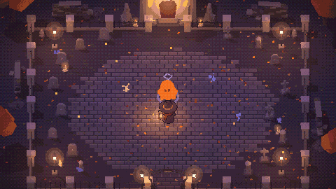
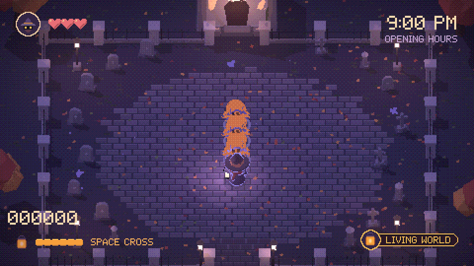

# Graveyard Shift

Player-facing instructions. Edit this file; `./build.sh` compiles it into the game bundle.

## Title

The dead don't stay dead.
Unfortunately, you're on the clock.

## How to play

Ghosts in the other world are dim. Cross through them to banish.

<!-- touch: Double-tap right on a dim ghost to dash at it. -->

## Tutorial tips

### Intro

Your shift begins at nine.
Please return the deceased to their graves.

### Cross

Dim ghosts are in the **other** world.
Face them and press `SPACE` or `DOUBLE TAP` to cross through.

<!-- touch: Dim ghosts are in the **other** world.
Face them (or aim at one) and **double-tap** to cross through. -->

### Wisp

"Not all the deceased are the same but, a gentle reminder
of their condition is usually sufficient."

## Menu clips

Shown on the pause menu **How to** tab.

### Cross

Face the ghosts and press `SPACE` or `DOUBLE TAP` to cross through.

<!-- touch: Face the ghosts and **double-tap** to cross through. -->

### Chain

Chain banishes to boost your score.

## Controls

### Keyboard

| Keys | Action |
| --- | --- |
| WASD / ARROWS | Move |
| SPACE | Cross worlds + dash |
| P / ESC | Pause / resume |
| R | Restart shift |
| M | Mute / unmute |

### Touch

| Gesture | Action |
| --- | --- |
| DRAG | Move (floating stick) |
| DOUBLE-TAP | Cross worlds + dash |
| TAP GHOST | Aim dash at a dim ghost |
| PAUSE BUTTON | Open this menu |
| RESUME | Clock back in |

## Outcomes

### Win

"Congratulations on completing your first shift.
Please report for duty tomorrow."

### Lose

The lantern gutters out at {time}.

## Toasts

### Midnight

Almost midnight. Hold on.
