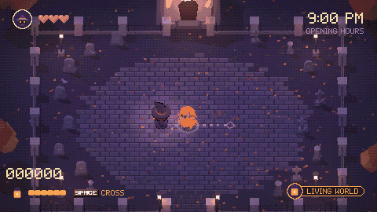

# Graveyard Shift

Player-facing instructions. Edit this file; `./build.sh` compiles it into the game bundle.

Keyboard copy is the default. Put mobile-only lines in `<!-- touch: … -->` comments (or use the Touch controls table). Wrap keys/gestures in backticks so they become pixel icons (`SPACE`, `DOUBLE TAP`, `DRAG`, `TAP`).

## Title

The dead don't stay dead.
Unfortunately, you're on the clock.

## How to play

Ghosts in the other world are dim. Cross through them to banish.

<!-- touch: `DOUBLE TAP` a dim ghost to dash at it. -->

## Tutorial tips

### Intro

Your shift begins at nine.
Please return the deceased to their graves.

### Cross

Dim ghosts are in the **other** world.
Face them and press `SPACE` to cross through.

<!-- touch: Dim ghosts are in the **other** world.
Face them (or aim at one) and `DOUBLE TAP` to cross through. -->

### Wisp

"Not all the deceased are the same but, a gentle reminder
of their condition is usually sufficient."

### Moth

Lantern Moths weave as they come.
Lead them with your dash.

### Bloom

Bloom Wraiths stay rooted and spray **pollen** in a fan.
Slip between the shots.

### Choir

The Ossuary Choir hides behind its skulls.
The **first** dash breaks the ring. The **second** sends it home.

### Bell

Bell Imps toll a **shockwave**.
Watch the ring flicker, then step aside, cross over or dash through it.

## Menu clips

Shown on the pause menu **How to** tab.

### Cross

Face the ghosts and press `SPACE` to cross through.

<!-- touch: Face the ghosts and `DOUBLE TAP` to cross through. -->

### Shift

Dim ghosts can't hurt you. Ghosts in your world can.

### Chain

Chain banishes to boost your score.

## Controls

### Keyboard

| Keys | Action |
| --- | --- |
| `WASD` / `ARROWS` | Move |
| `SPACE` | Cross worlds + dash |
| `I` / `TAB` | Open the bag (Night Shift) |
| `1`-`5` | Use a bag item |
| `P` / `ESC` | Pause / resume |
| `R` | Restart shift |
| `M` | Mute / unmute |

### Touch

| Gesture | Action |
| --- | --- |
| `DRAG` | Move (floating stick) |
| `DOUBLE TAP` | Cross worlds + dash |
| `TAP` Ghost | Aim dash at a dim ghost |
| Bag | Open the bag, tap an item to use it |
| Pause | Open this menu |
| `TAP` | Clock back in |

## Outcomes

### Win

"Congratulations on completing your first shift.
Please report for duty tomorrow."

### Lose

The lantern gutters out at {time}.

## Toasts

### Midnight

Almost midnight. Hold on.
