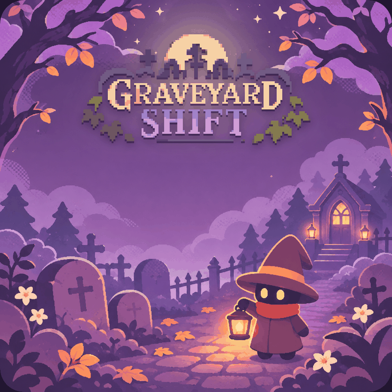

The dead don't stay dead. Unfortunately, you are on the clock.

Graveyard Shift is a game where the living and spirit worlds overlap. Dashing switches you between the two worlds and banishes any ghosts you cross in the world you are leaving. Enemies in the other world are faded out, but they can still follow you.

Night Shift contains 6 courts and a main story.

Overtime is endless gameplay.

You can choose one relic after clearing each of the first five courts.

- **Pocket Watch:** Reduces dash cooldown.
- **Caretaker's Key:** Increases dash distance.
- **Spirit Bubble:** Blocks one hit, even at full health, and disappears after use.

Banished ghosts can drop pickups. Found items go in the bag.

**The Old Churchyard** is the starting court. The arena has a circular cobblestone path, graves along the grass, a chapel, and an exit at the south gate. There are three waves of enemies, with fast-moving moths appearing in the last wave. Clear all three, pick a relic, and leave through the gate.

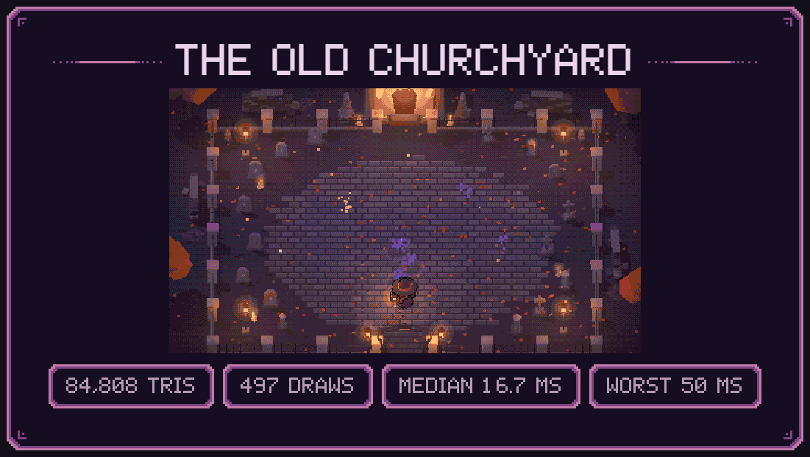

**Forgotten Gardens** has a fountain in the middle and two pairs of teleporting arches, one east to west and the other north to south. Enemies can use the arches too. Bloom wraiths stay in place and fire a spread of pollen across the paths.

**Catacombs** has bone walls, stairs at the south end, and six barriers that divide the arena. Some barriers block movement in the living world, while others block movement in the spirit world. The south wall is half height to keep the arena visible. The choir has rotating skulls that absorb the first dash hit, leaving its body open to the next one.

**The Last Ward** takes place in a marble hall with stained glass, a sarcophagus, and four pillars. Enemies target the nearest pillar instead of focusing on you. Protect the pillars for three waves. Each surviving pillar is worth 500 points, and losing all four ends the run.

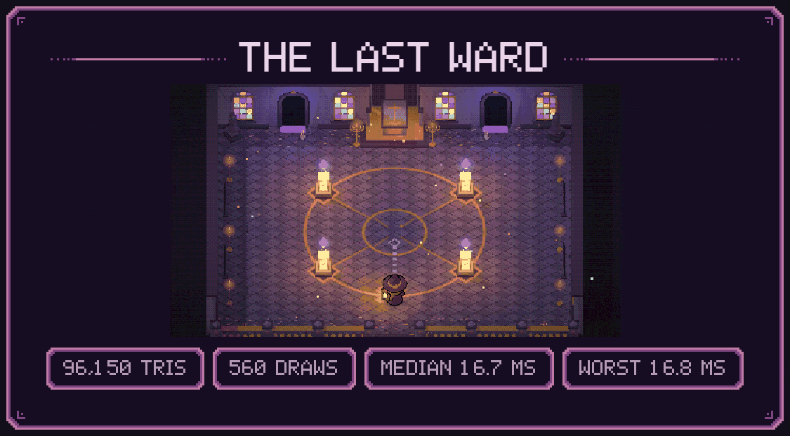

**Hollow Grounds** is an open field surrounded by ruins, dead trees, and graves, with a shrine in the center. Banished enemies drop souls that you can collect and deposit at the shrine. Deposit 25 souls to clear the court. Taking a hit causes you to drop the souls you are carrying.

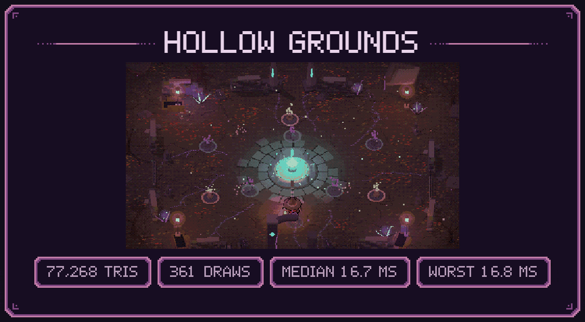

**The Bell Tower** is a rooftop arena with a large bell at the north end. This is where you fight the Hollow Warden. It can only take damage in one world at a time and switches worlds after each successful hit. Land 12 hits to finish Night Shift.

*Disclaimer: The counts and frame times shown on the cards were recorded on this machine using software GL. Performance may vary on other hardware.*

A closer look at the character, enemy, and environment models, grouped by where they appear in the game.

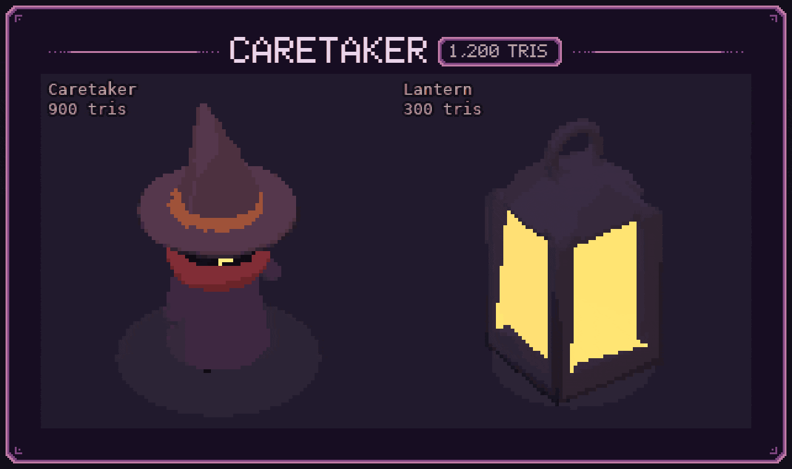

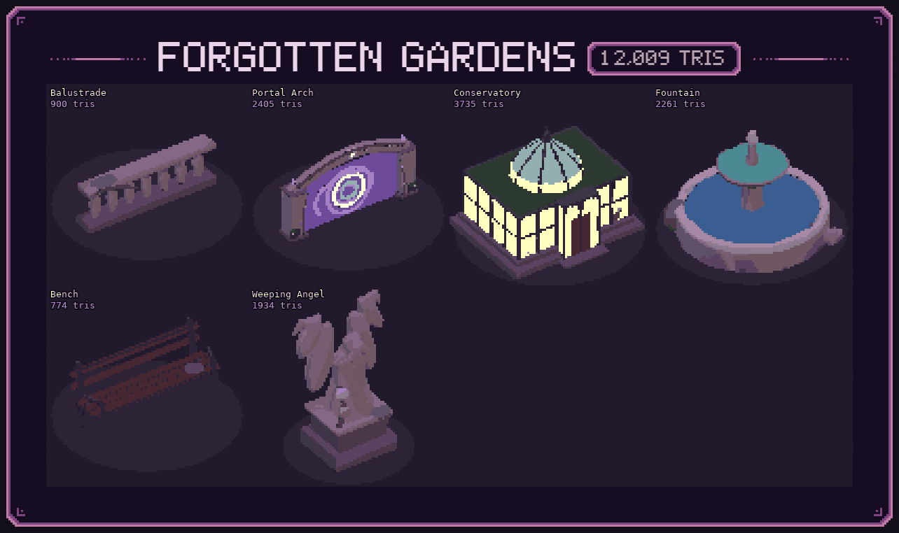

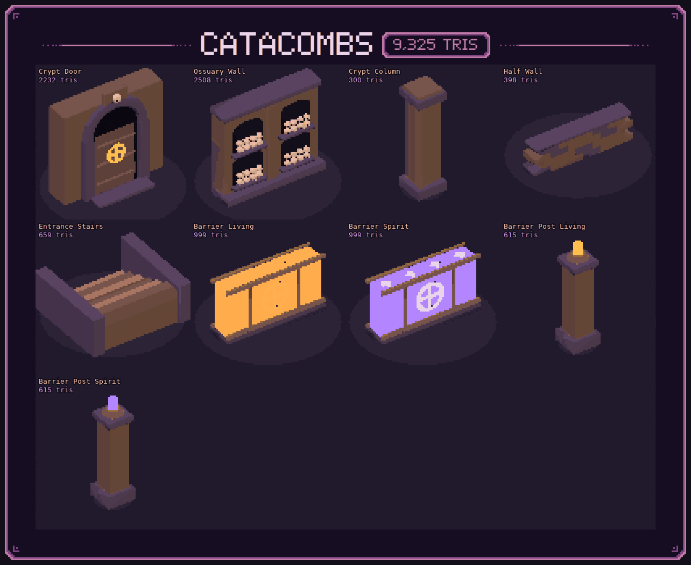

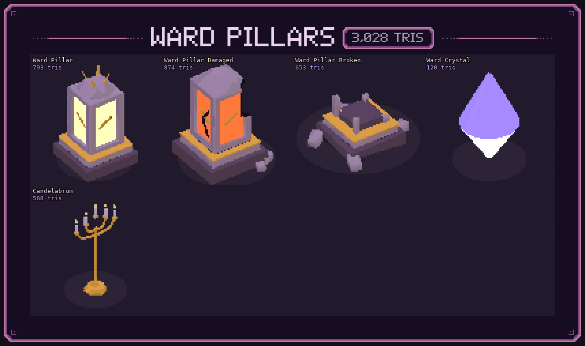

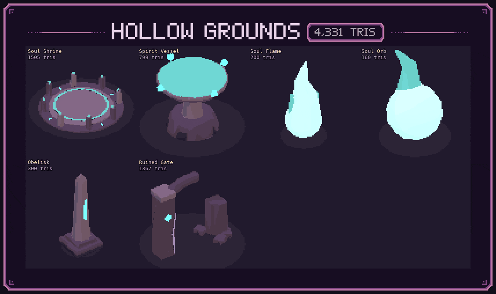

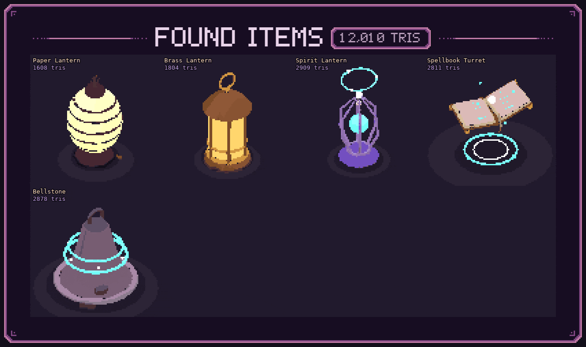

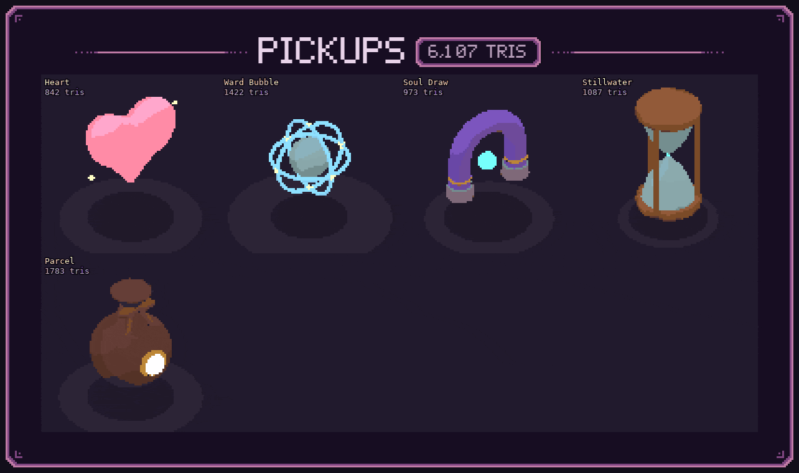

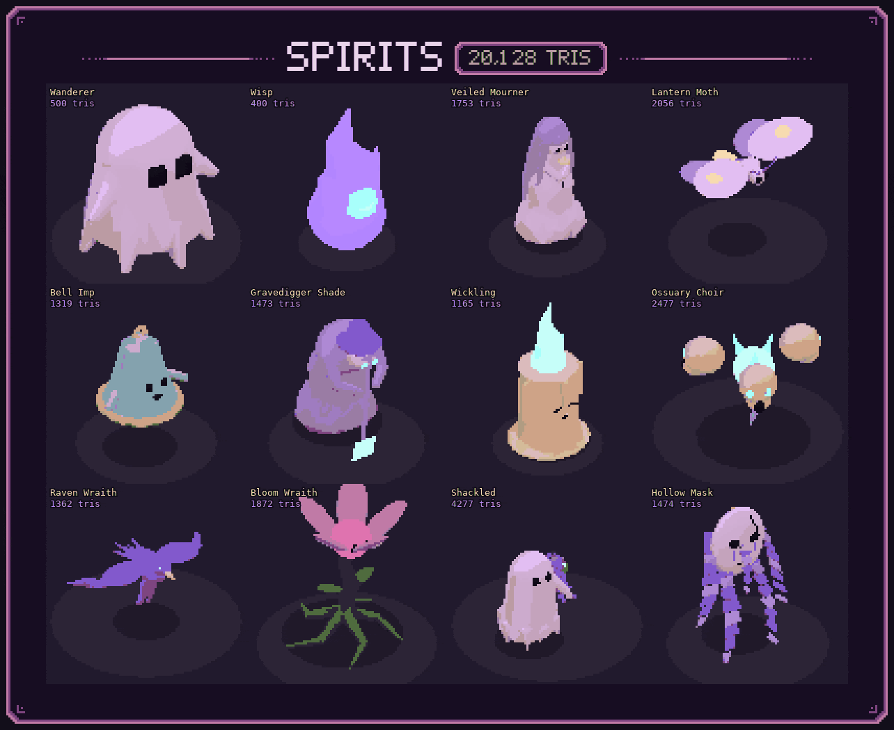

