

The dead don't stay dead. Unfortunately, you are on the clock.

Two worlds share the ground. You stand in one. A dash puts you in the other, and the ghosts you cross on the way out are banished. Whatever you left behind only goes dim. It still comes toward you.

Night Shift is six courts and then morning. Hearts, score, and relics come with you. Clear a court and you choose one thing to keep. A way out opens after that. Walk into it. The sixth court does not offer a relic. It offers the Warden, and winning there ends the night.

Overtime never leaves the churchyard. You get three minutes. The clock is the job.

Quick Shift is lettered on the board. The door is still shut.

Walk with WASD or the arrows. Space is the dash, and the dash is how you fight. On a phone the stick walks, and a double tap crosses.

You have three hearts. A hit takes one and leaves a short breath where nothing else can land. Keep banishing and the score climbs. Let the streak go cold and it drops.

Wisps shoot. Wanderers close in. Pause with P or Esc.

On Night Shift, R returns you to the door of the court you are already in, with the hearts and relics you had when you entered. In Overtime, R starts the three minutes again.

Each of the first five courts lets you take one on the way out.

The Pocket Watch shortens the wait before you can dash again. The Caretaker's Key makes that dash reach farther. The Spirit Bubble spends itself on one hit, even when you are already at full hearts. Then it is gone.

The churchyard is the court you already work. Cobbles in a ring, graves kept out on the grass, the chapel shut and the south gate lit. Three rounds of ordinary dead. The last round brings moths, fast and annoying to catch in the right world. When the court is quiet, take a relic and go out by the gate.

The gardens are still in flower. That is not a kindness. Paths meet at a fountain you have to go around. Arches stand to the east and west, and another pair to the north and south. Step through one and you come out of its opposite. So does anything that is after you. Off the paths, bloom wraiths root where they stand and throw a fan of pollen over the lane.

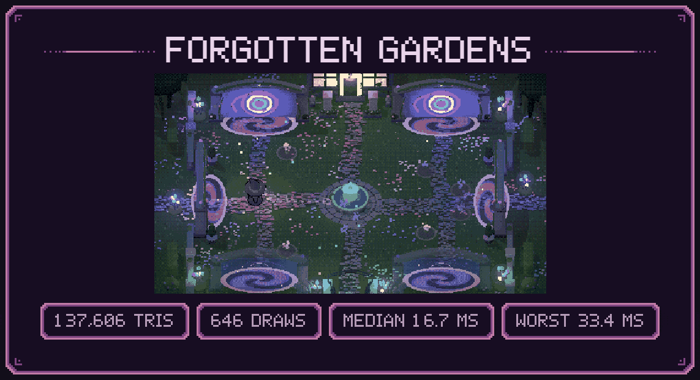

Below that, the walls are built of bone. The south side is only half height, so the room stays readable, and the stairs come up through it. Six barriers divide the floor. One stops you in the living world and lets the other world pass. One does the reverse. The choir hangs in the middle with its skulls turning. The skulls take the first dash. The body takes the next.

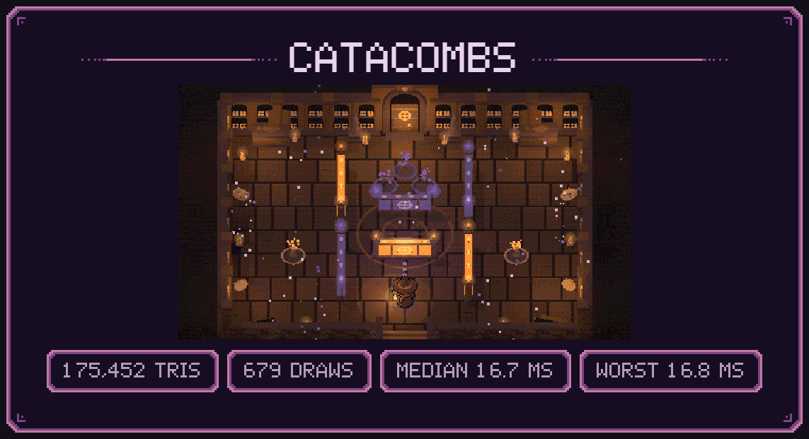

The last ward is a marble hall. Stained glass along the north wall, a sarcophagus set back in the recess, four pillars standing in the open. The dead here want the pillars more than they want you. They break the nearest one. Three waves. Each pillar still up at the end is worth five hundred points. If the last one falls, the night falls with it.

Hollow Grounds is an open field with a shrine in the middle, small enough to walk into. Ruins, dead trees, and open graves stay out on the edge. Banish something and it leaves a soul. Pick it up, carry it in, bank it. Twenty-five banked and the court is done. Take a hit while you are carrying them and they spill.

The bell tower is a rooftop, close to eight sides, with the great bell hung to the north and the rest of the cemetery a drop past the parapet. The Hollow Warden waits on the ring. It can only be hurt in one world at a time. A dash in that world takes one off it, and then it swaps worlds. Twelve, and the shift is over.

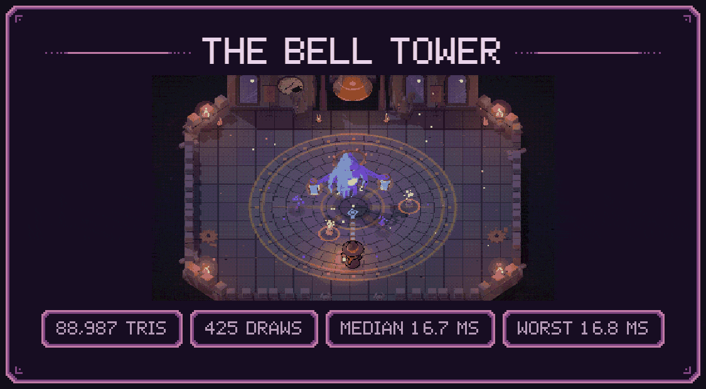

The counts and frame times on the cards were measured on this machine under software GL. They are a reading, not a promise.

The models, in the groups they share.

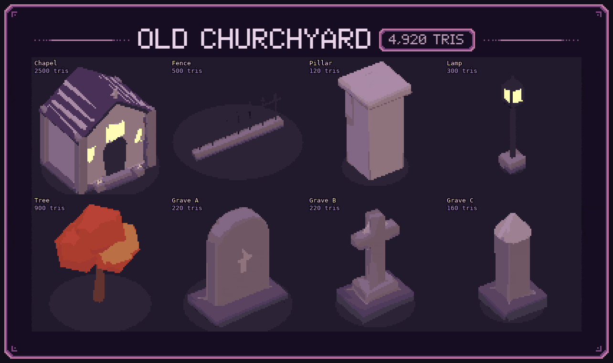

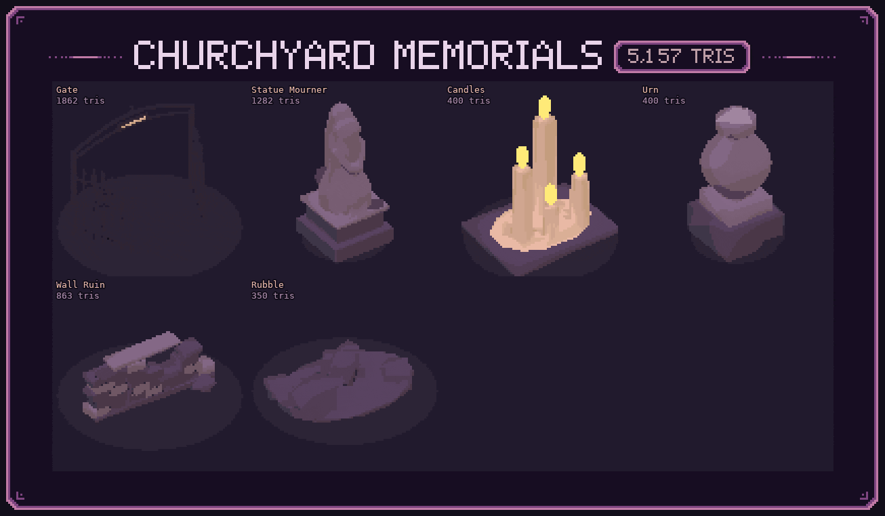

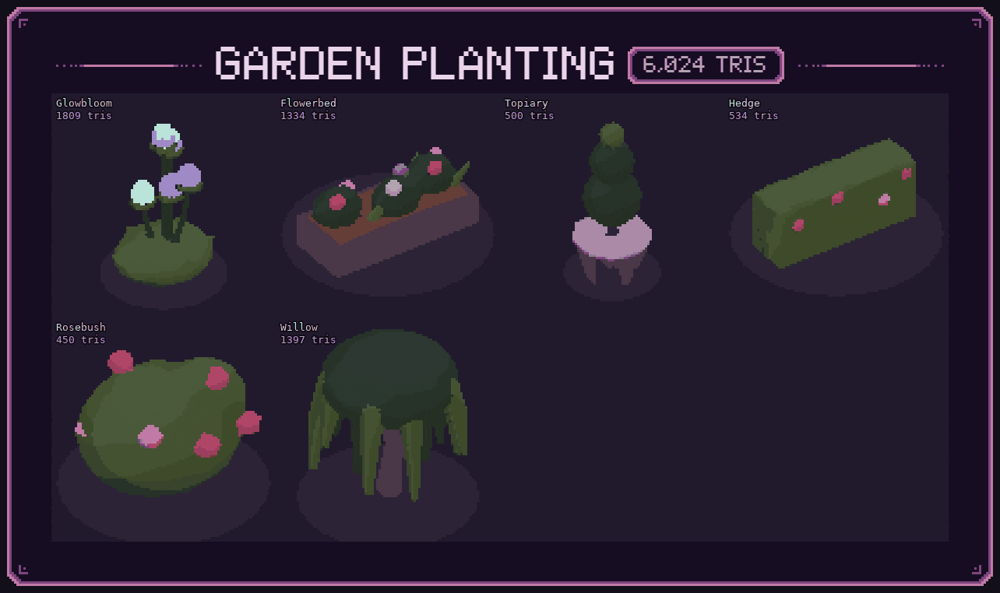

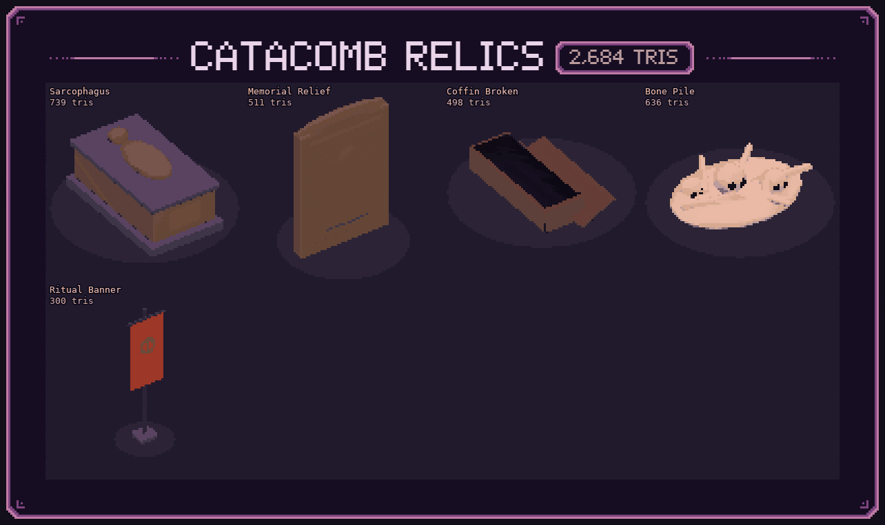

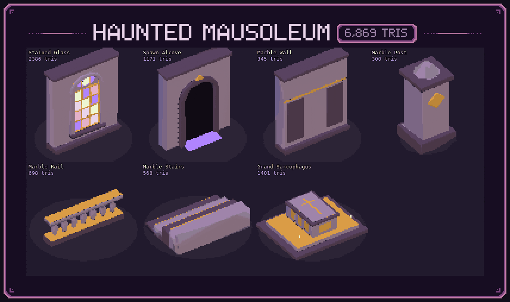

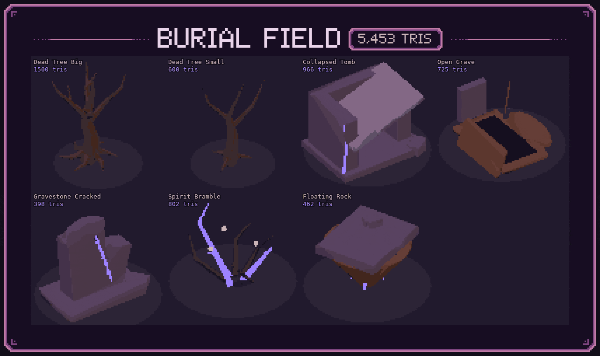

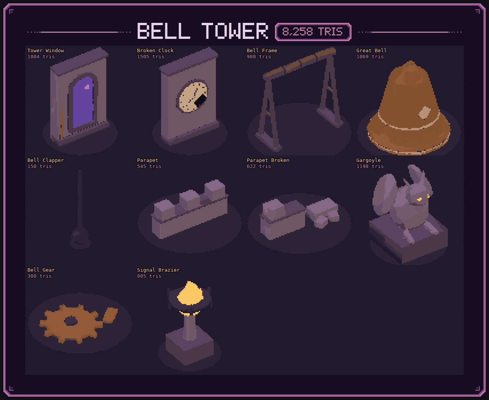

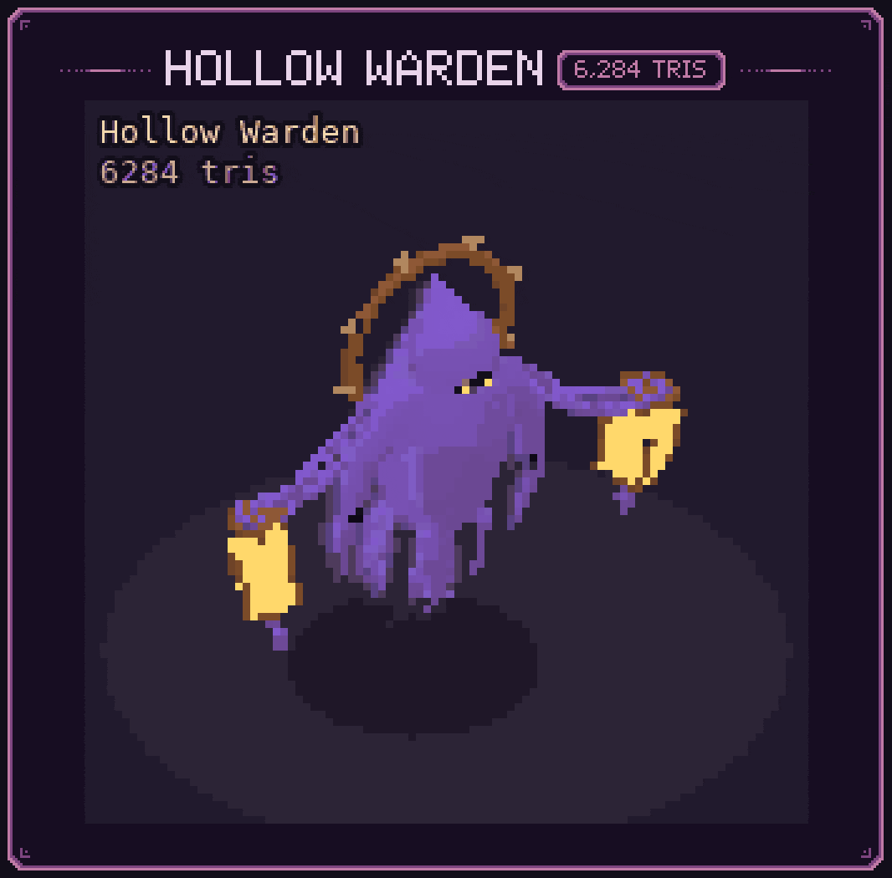

